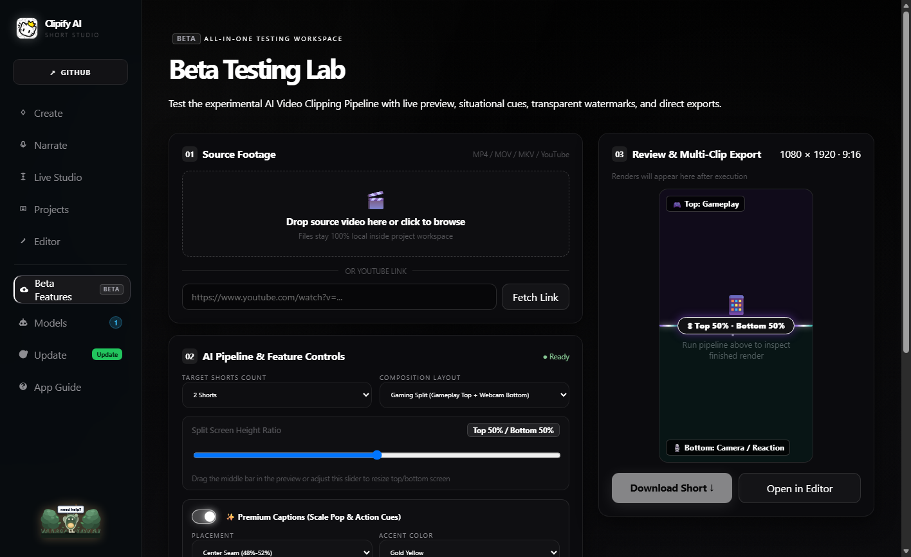
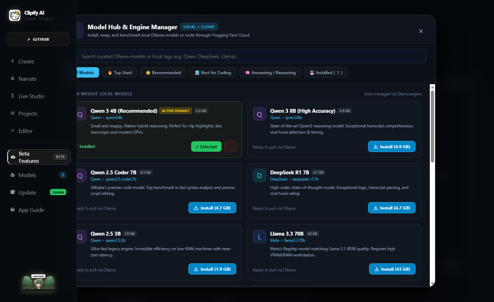
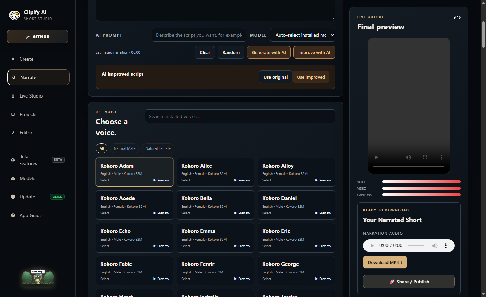

<div align="center">

# 🎬 Clipify AI: Free & Open-Source AI Video Clipper, LIVE Stream Clipping & Shorts Studio

### Turn long videos & livestreams into viral vertical 9:16 Shorts with local AI highlight ranking, animated captions, Clippy AI assistant & faceless narration.

**100% Free · Private & Local · No Cloud Subscriptions · No Watermarks · No Video Limits**

<p align="center">
  <a href="https://github.com/sherlock-dev-ai/Clipify-AI-Video-Clipper-FREE/releases/tag/v4.0.9"><strong>Download v4.0.9 Release (Windows x64) »</strong></a>
  <br>
  <a href="https://ai.projectclipzy.workers.dev/">Project Website</a> ·
  <a href="#-key-features">Key Features</a> ·
  <a href="#-screenshots">Screenshots</a> ·
  <a href="#-live-studio-beta">Live Studio</a> ·
  <a href="#-quick-start">Quick Start</a> ·
  <a href="#-clipper-vs-competitors">Comparison</a> ·
  <a href="#-local-ai-engine">Local AI Engine</a>
</p>

[](https://github.com/sherlock-dev-ai/Clipify-AI-Video-Clipper-FREE/releases/tag/v4.0.9)
[](https://github.com/sherlock-dev-ai/Clipify-AI-Video-Clipper-FREE/releases/tag/v4.0.9)
[](LICENSE)
[](https://python.org)
[](https://ollama.ai)

</div>

---

> [!TIP]
> 💬 **Community & Clips Sharing**: Join our Instagram group chat to discuss features and share clips: [**Instagram Group Chat**](https://ig.me/j/AQj1lYCWh_iV_S7J/)

---

## ⚡ What is Clipify AI?

**Clipify AI** is an open-source, full-stack creator workspace and private desktop alternative to expensive cloud services like OpusClip, Munch, and Submagic. It brings state-of-the-art AI video clipping, real-time livestream monitoring, gaming split-screen facecam reframing, Hormozi-style animated word subtitles, an intelligent slide-out AI assistant (**Clippy AI**), and a neural voice narration generator directly onto your local machine.

Everything runs on your computer—preserving **100% privacy**, with **zero monthly subscription fees**, **zero API costs**, and **no video length quotas**.

---

## 📥 Download (v4.0.9 Latest)

> [!IMPORTANT]
> **🛡️ Note on Windows SmartScreen & Smart App Control**:
> Clipify AI is **100% free, local, clean, and open-source software**.
> Commercial vendors pay thousands of dollars annually for EV Code Signing Certificates. Because Clipify AI is a free community open-source project without expensive corporate certificates, Microsoft Windows Defender SmartScreen may display **"Windows protected your PC (unrecognized app)"**.
>
> **How to run in 2 seconds:**
> 1. Click **"More info"** on the Windows SmartScreen blue prompt.
> 2. Click the **"Run anyway"** button.

| Package | Platform | Version | Size | Download | SHA-256 Checksum |
| :--- | :---: | :---: | :---: | :--- | :--- |
| **`Clipify.AI.Setup.4.0.9.exe`** | Windows 10/11 (64-bit) | `v4.0.9` | **331.8 MB** | [**Download Windows Installer**](https://github.com/sherlock-dev-ai/Clipify-AI-Video-Clipper-FREE/releases/download/v4.0.9/Clipify.AI.Setup.4.0.9.exe) | `F47FE2D410BCA47E1139CD7ED264971138AB50EA0C1A3F70F29608F9813771A1` |
| **`update-v4.0.9.zip`** | In-Place Hot Patch | `v4.0.9` | **3.3 MB** | [**Download Fast Update ZIP**](https://github.com/sherlock-dev-ai/Clipify-AI-Video-Clipper-FREE/releases/download/v4.0.9/update-v4.0.9.zip) | Fast in-place updater asset |
| **`Clipify AI (beta).apk`** | Android 8.0+ | `v3.9.0` | **13.8 MB** | [**Download Android APK**](https://github.com/sherlock-dev-ai/Clipify-AI-Video-Clipper-FREE/releases/download/v3.9.0/Clipify.AI.beta.apk) | Community mobile companion |

#### Verify SHA-256 Integrity:
```powershell
Get-FileHash ".\Clipify.AI.Setup.4.0.9.exe" -Algorithm SHA256
```

---

## 🌟 Key Features

### 1. 🤖 Clippy AI Side Assistant
- **Project Knowledge Assistant**: Click the floating assistant arrow on the right to open your dedicated AI sidekick. Clippy knows everything about Clipify AI, hotkeys, features, and troubleshooting.
- **Auto-Pairs with Fastest Ollama Model**: Automatically benchmarks and routes queries to your fastest local Ollama model (`qwen2.5`, `llama3.2`, `mistral`, `gemma`) with instant fallback.
- **Thinking Animation & UI Integration**: Fluid typewriter streaming with animated typing indicators and responsive theme matching.

### 2. ✨ Anti-Burst Upscale Quality Engine
- **Selectable Render Profiles**:
  - **Ultra (Crisp 1080p)**: Lanczos scaling, accurate rounding, unsharp masking, CRF 16–17, 10–14 Mbps bitrate.
  - **High (Balanced Crisp)**: Bicubic scaling, subtle sharpening, CRF 18–19, 8–10 Mbps bitrate.
  - **Balanced (Standard Quality)**: Fast encoding, CRF 20–22, 5–6 Mbps bitrate.
  - **Fast (Draft Preview)**: Bilinear scaling, CRF 23–25, compact export file size.
- **Zero Quality Loss on Rescaling**: Prevents macroblocking, digital pixel blowout, and bitrate bursts during high-motion vertical crops, 3D games, and high-contrast dialogue scenes.

### 3. 🎙️ Enhanced 2-Person Podcast & Split-Screen Framing
- **Studio-Quality Podcast Split**: Intelligently frames Speaker 1 in the top panel and Speaker 2 in the bottom panel with natural torso/headroom margins.
- **Pristine Native Encoding**: Direct FFmpeg pipeline with 192k audio and Lanczos filtering; eliminates low-quality intermediate re-encoding.
- **Draggable Split-Screen Resizer**: Drag the interactive divider bar in the 9:16 player or slide the precision control from **Top 30% / Bottom 70%** through **Top 70% / Bottom 30%**.

### 4. 🔴 Live Studio (Real-Time Livestream AI Clipper)
- **Multi-Platform Ingestion**: Connect directly to **YouTube Live**, **Twitch**, **Kick**, or local **OBS Studio** via RTMP (`rtmp://127.0.0.1:1935/live`).
- **Intelligent Streamer Facecam Isolation**: Spatial cluster filtering distinguishes between moving in-game characters and fixed streamer webcam overlays, ensuring 100% clean gameplay top / facecam bottom splits.
- **Instant & Batch Highlights**: Extract 15s, 30s, or 60s clips on demand or batch-generate ranked Shorts automatically while streaming.

### 5. ✏️ Beta Lab Draggable & Timed Text Overlays
- **Interactive On-Canvas Dragging**: Position your custom text anywhere on the 9:16 video frame by dragging it directly.
- **Precise Timing Sliders**: Set custom start timestamps (`From: 0.0s`) and end timestamps (`To: 15.0s`) for each text card.
- **Complete Typography Controls**: Font size, color picker, background banner toggle, opacity, and real-time canvas preview.

### 6. 🖼️ Custom Logo & Watermark Precision Tools
- **Transparency & Opacity Control**: Adjust logo opacity smoothly from 0% to 100%.
- **Scale & Sizing**: Scale your channel mark from 5% to 50% of the video canvas with automatic aspect ratio preservation.
- **Smart Background Removal**: Built-in chroma key color-matching to remove solid backgrounds from logos automatically.

### 7. 🗺️ Contextual App Guide & Animated Visual Tour
- **Context-Aware Focus**: Launching App Guide inside Beta Lab or Live Studio highlights only relevant tools for that specific screen.
- **Aesthetic Animated Curved Dotted Lines**: Non-AI, professional UI connectors with section-themed color gradients that smoothly track each target component.

### 8. ⚡ Instant In-App Zero-Reinstall Updater
- **One-Click Upgrades**: Check for updates and patch your installation directly from the in-app **Update** button in under 5 seconds.
- **Pre-Bundled VC++ Runtimes**: Automated detection and injection of Microsoft Visual C++ redistributables and runtime DLLs.

---

## 📸 Screenshots

### 🎬 Studio Overview & Navigation
<p align="center">
  
</p>

| 🧪 Beta Testing Lab (Draggable Split Resizer) | 🤖 Model Hub & Engine Manager |
| :---: | :---: |
|  |  |

| 🎙️ Narrate Studio (Neural Voices) | 🔴 Live Studio Stream Clipping |
| :---: | :---: |
|  |  |

| 🎛️ 9:16 Vertical Video Editor | 🎭 Gaming Split-Screen Mode |
| :---: | :---: |
|  |  |

---

## 🥊 Clipper vs Competitors

| Feature | OpusClip | Munch / Submagic | Clipify AI (v4.0.9) |
| :--- | :---: | :---: | :---: |
| **Pricing** | $19 – $49/mo | $20 – $50/mo | **100% Free & Open-Source** |
| **Video Processing** | Cloud (Queues / Limits) | Cloud (Usage Quotas) | **100% Local (Private & Unlimited)** |
| **Watermarks** | Yes (Free tier) | Yes (Free tier) | **None (Clean Video Exports)** |
| **AI Highlight Detection** | Proprietary Cloud | Proprietary Cloud | **Local Ollama / Qwen** |
| **Clippy AI Assistant** | ❌ | ❌ | **✅ Built-in Sidekick** |
| **Anti-Burst Upscaling** | ❌ | ❌ | **✅ Ultra / High / Balanced** |
| **Draggable Split Screen** | ❌ | ❌ | **✅ Interactive (30% to 70%)** |
| **Timed Text Overlays** | ❌ | ❌ | **✅ Built-in Timeline Editor** |
| **Faceless Narrator Studio** | ❌ | ❌ | **✅ Built-in (Kokoro + SAPI)** |
| **In-Place Live Updater** | ❌ | ❌ | **✅ 1-Click Fast Update** |

---

## 🚀 Quick Start

### Method 1: Windows 1-Click Installer (Recommended)

1. Download **[`Clipify.AI.Setup.4.0.9.exe`](https://github.com/sherlock-dev-ai/Clipify-AI-Video-Clipper-FREE/releases/download/v4.0.9/Clipify.AI.Setup.4.0.9.exe)** from the latest release.
2. Launch the installer. It will automatically:
   - Configure Python 3.11 embedded runtime.
   - Install required FFmpeg, WhisperX, and PyTorch dependencies.
   - Detect or pull local Ollama models (`qwen2.5:3b` / `qwen3:4b`).
   - Create desktop shortcuts.
3. Open **Clipify AI** from your desktop and start clipping!

---

### Method 2: Manual Developer Setup (From Source)

```powershell
# 1. Clone the repository
git clone https://github.com/sherlock-dev-ai/Clipify-AI-Video-Clipper-FREE.git
cd Clipify-AI-Video-Clipper-FREE

# 2. Create and activate a Python 3.11 virtual environment
py -3.11 -m venv .venv
.\.venv\Scripts\Activate.ps1

# 3. Install Python dependencies
pip install -r requirements-runtime.txt

# 4. Pull your preferred Ollama model
ollama pull qwen2.5:3b

# 5. Launch Clipify AI Studio
python app.py
```

Open `http://127.0.0.1:5000` in your browser.

---

## 📄 License & Credits

This project is licensed under the **Creative Commons Attribution-NonCommercial 4.0 International License (CC BY-NC 4.0)**.

- **Attribution**: You must give appropriate credit to the creator (`sherlock-dev-ai`) and provide a link to the [official repository](https://github.com/sherlock-dev-ai/Clipify-AI-Video-Clipper-FREE).
- **Non-Commercial**: Free for personal, non-commercial use.
- **Commercial Licensing**: For commercial licensing inquiries, please contact: `betterpopcorns@gmail.com`.

Developed with ❤️ by [sherlock-dev-ai](https://github.com/sherlock-dev-ai).

**Contact & Support**:
- Instagram: **sherlock.fy**
- Discord: **sherlock.fy**

⭐ Star the repository if you love Clipify AI!
