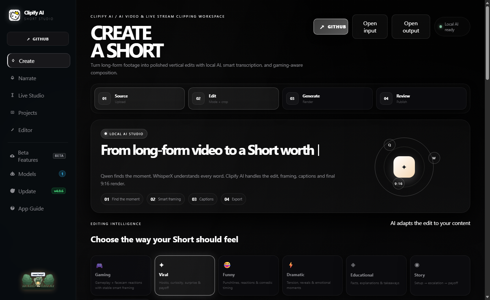

<div align="center">

# 🎬 Clipify AI: Free & Open-Source AI Video Clipper, LIVE Stream Clipping & Shorts Studio

### Turn long videos & livestreams into viral, vertical 9:16 Shorts with AI highlights, animated captions & faceless narration.

**100% Free · Private & Local · No Cloud Subscriptions · No Watermarks**

<p align="center">
  <a href="https://github.com/sherlock-dev-ai/Clipify-AI-Video-Clipper-FREE/releases/tag/v3.9.0"><strong>Download v3.9.0 Release (Windows & Android) »</strong></a>
  <br>
  <a href="https://ai.projectclipzy.workers.dev/">Project Website</a> ·
  <a href="#-key-features">Key Features</a> ·
  <a href="#-live-studio-beta">Live Studio</a> ·
  <a href="#-quick-start">Quick Start</a> ·
  <a href="#-clipper-vs-competitors">Comparison</a> ·
  <a href="#-local-ai-engine">Local AI Setup</a>
</p>

[](https://github.com/sherlock-dev-ai/Clipify-AI-Video-Clipper-FREE/releases/tag/v3.9.0)
[](https://github.com/sherlock-dev-ai/Clipify-AI-Video-Clipper-FREE/releases/tag/v3.9.0)
[](LICENSE)
[](https://python.org)
[](https://ollama.ai)

</div>

---

## ⚡ What is Clipify AI?

**Clipify AI** is an open-source, full-stack creator suite and desktop alternative to expensive cloud platforms like OpusClip, Munch, and Submagic. It brings state-of-the-art AI video clipping, real-time livestream monitoring, gaming split-screen facecam reframing, Hormozi-style animated word subtitles, and an AI narration generation studio directly onto your local machine and Android devices.

Everything runs on your computer—preserving **100% privacy**, with **zero monthly subscription fees**, **zero API costs**, and **no video length quotas**.

---

## 📥 Download (v3.9.0)

> [!IMPORTANT]
> **🛡️ Why Windows SmartScreen / Antivirus Flags New Releases (False Positive Explanation)**:
> Clipify AI is **100% free, local, clean, and open-source software**.
> Commercial software vendors pay thousands of dollars annually for EV Code Signing Certificates. Because Clipify AI is a community open-source project without expensive corporate certificates, Microsoft Windows Defender SmartScreen has not accumulated worldwide cloud telemetry on newly released binary hashes yet, displaying **"Windows protected your PC (unrecognized app)"**.
>
> **How to run in 2 seconds:**
> 1. Click **"More info"** on the Windows SmartScreen blue dialog.
> 2. Click the **"Run anyway"** button.
>
> **Alternative Fix:** Right-click `Clipify.AI.Setup.3.9.0.exe` → **Properties** → Check **"Unblock"** at bottom → Click **OK**.

| Package | Platform | Version | Size | Download |
| :--- | :---: | :---: | :---: | :--- |
| **`Clipify.AI.Setup.3.9.0.exe`** | Windows 10/11 (64-bit) | `v3.9.0` | **331.4 MB** | [**Download Windows Installer (x64)**](https://github.com/sherlock-dev-ai/Clipify-AI-Video-Clipper-FREE/releases/download/v3.9.0/Clipify.AI.Setup.3.9.0.exe) |
| **`Clipify AI (beta).apk`** | Android 8.0+ (ARM64/x86) | `v3.9.0` | **13.8 MB** | [**Download Android APK (beta)**](https://github.com/sherlock-dev-ai/Clipify-AI-Video-Clipper-FREE/releases/download/v3.9.0/Clipify.AI.beta.apk) |

#### Verify SHA-256 integrity:
```powershell
Get-FileHash ".\Clipify.AI.Setup.3.9.0.exe" -Algorithm SHA256
# SHA-256: 1F6DAF2F4C8D53D0C53D2B2CF99AA0A5DCD63DC97818EE169ECFA88704F8B03A

Get-FileHash ".\Clipify AI (beta).apk" -Algorithm SHA256
# SHA-256: e1580152557b84b03f9777fcaf5403400414a671e9adcf66bb9c48f0fb9e21bb
```

---

## 🌟 Key Features

### 1. 🔴 Live Studio [BETA] (Real-Time Livestream AI Clipper)
- **Live Ingestion**: Connect directly to any **YouTube Live** stream or local **OBS Studio** via RTMP (`rtmp://127.0.0.1:1935/live`).
- **Watch Like The Stream**: Integrated live stream player with real audio and video playback, plus a snapshot diagnostic view.
- **Instant & Batch Clipping**: Dedicated `⚡ Clip Highlight` (15s, 30s, 60s) and `🎬 Generate 4 Clips` batch partitioning to extract viral moments on the fly.
- **Smart AI Reframing & Gaming Layout**: Intelligently detects gameplay and facecam to render 58% gameplay / 42% reaction split-screens.
- **Full Customization**: Choose custom fonts (*Montserrat, Arial Black, Impact, Segoe UI, etc.*), custom canvas backgrounds (*Soft Blur, Cinematic Blur, Solid Black, Brand Color*), custom watermark text branding, or disable captions completely.

### 2. 🎯 AI Video Clipping & Viral Highlight Scoring
- **Automated Ingestion**: Paste a YouTube link or drag-and-drop MP4/MOV/MKV/WEBM footage.
- **Word-Level Transcription**: Fast, accurate speech-to-text powered by WhisperX.
- **LLM Virality Scoring**: Uses local Ollama models (`qwen2.5:3b`, `qwen2.5:8b`, etc.) or built-in fast AI to rank conversation hooks, humor, drama, or actionable advice.
- **Automatic Titles & Descriptions**: Generates high-CTR titles, hashtags, and social descriptions ready for YouTube Shorts, Instagram Reels, and TikTok.

### 3. 📐 Smart 9:16 Face-Tracking & 2-Panel Split-Screen
- **Active Speaker Tracking**: Computer-vision face detection smoothly centers subjects in a vertical 9:16 frame with EMA jitter smoothing.
- **Gaming Split-Screen Mode (Toggleable)**: When **enabled**, renders full widescreen gameplay on top (1080x1080) and streamer webcam on bottom (1080x840). When **disabled**, automatically switches to 2-person podcast split mode (Speaker 1 on top, Speaker 2 on bottom).
- **Turbo Whisper Engine**: Optional high-speed transcription toggle for instant speech-to-text processing on standard CPUs.

### 4. 🎨 Dynamic Animated Captions (Hormozi / Viral Style)
- **Active Word Highlighting**: Karaoke-style word highlighting with customizable accent colors (Neon Yellow, Coral, Cyan, Green).
- **Creator Font Library**: Includes Montserrat Extra Bold, The Bold Font, Komika Axis, Anton, and more.
- **Customizable Layout**: Adjust caption placement, font size, stroke thickness, and drop shadow.

### 5. 🎛️ Built-in 9:16 Vertical Video Editor
- **Real-Time 9:16 Preview**: True vertical player with zero letterboxing or distortion.
- **Post-Render Watermarking & Branding**: Overlay custom logos, adjust opacity and scale, or strip transparent backgrounds automatically with built-in chroma-keying.
- **One-Click Share & Export**: Instant download or export directly from your local project library.

### 6. 🎙️ Narrate Studio (Faceless Shorts Generator)
- **AI Story & Script Generation**: Turn any idea into a viral script using local LLMs with custom storytelling prompts.
- **Dual Voice Engines**: Kokoro Neural TTS and Windows SAPI TTS with sub-2ms audio preview caching.
- **Curated Background Footage**: Pick from clean stock backgrounds and render a complete faceless short in seconds.

---

## 📸 Screenshots

### 🔴 Live Studio: Real-Time LIVE Stream Clipping & Export-Ready Shorts
<p align="center">
  
</p>

| 🎬 Short Studio Dashboard | 🎙️ Narrate Studio (Faceless Shorts) |
| :---: | :---: |
|  |  |

| 🎛️ 9:16 Vertical Video Editor | 🎭 2-Panel Split-Screen Mode |
| :---: | :---: |
|  |  |

| 🎮 Interactive Installer with Live Telemetry | 📂 Projects Library |
| :---: | :---: |
|  |  |

---

## 🥊 Clipper vs Competitors

| Feature | OpusClip | Munch / Submagic | Clipify AI (v3.5.4) |
| :--- | :---: | :---: | :---: |
| **Pricing** | $19 – $49/mo | $20 – $50/mo | **100% Free & Open-Source** |
| **Video Processing** | Cloud (Queues / Limits) | Cloud (Usage Quotas) | **100% Local (Private & Unlimited)** |
| **Watermarks** | Yes (Free tier) | Yes (Free tier) | **None (Clean Video Exports)** |
| **AI LLM Highlight Detection** | Proprietary Cloud | Proprietary Cloud | **Local Ollama / Qwen** |
| **Animated Word Captions** | ✅ | ✅ | **✅ (Multiple Creator Fonts)** |
| **2-Panel Split Screen** | Limited | Limited | **✅ Built-in** |
| **Faceless Narration Studio** | ❌ | ❌ | **✅ Built-in (Kokoro + SAPI)** |
| **Custom Code & Extensibility**| ❌ | ❌ | **✅ Full Python / JS Source** |

---

## 🚀 Quick Start

### Method 1: Windows 1-Click Installer (Recommended)

1. Download **[`Clipify.AI.Setup.exe`](https://github.com/sherlock-dev-ai/Clipify-AI-Video-Clipper-FREE/releases/download/v3.1.0/Clipify.AI.Setup.exe)** from the latest release.
2. Launch the installer. It will automatically:
   - Configure Python 3.11 embedded runtime.
   - Install required FFmpeg, WhisperX, and PyTorch dependencies.
   - Detect or pull local Ollama models (`qwen2.5:3b` / `qwen2.5:8b`).
   - Create desktop shortcuts.
3. Open **Clipify AI** from your desktop and start clipping!

---

### Method 2: Manual Developer Setup (From Source)

#### Prerequisites:
- Windows 10/11 (64-bit)
- Python 3.11+
- [Git](https://git-scm.com/)
- [Ollama](https://ollama.ai/) (optional for LLM highlight scoring)
- NVIDIA GPU with CUDA recommended (CPU supported)

```powershell
# 1. Clone the repository
git clone https://github.com/sherlock-dev-ai/Clipify-AI-Video-Clipper-FREE.git
cd Clipify-AI-Video-Clipper-FREE

# 2. Create and activate a Python 3.11 virtual environment
py -3.11 -m venv .venv
.\.venv\Scripts\Activate.ps1

# 3. Install Python dependencies
pip install -r requirements-runtime.txt

# 4. Pull your preferred Ollama model
ollama pull qwen2.5:3b
# Or for higher quality:
# ollama pull qwen2.5:8b

# 5. Launch Clipify AI Studio
python app.py
```

The web studio will launch automatically in your browser at `http://127.0.0.1:5000`.

---

## 🧠 Local AI Engine

Clipify AI is built on local privacy. It connects seamlessly to a local [Ollama](https://ollama.ai) daemon running on `http://127.0.0.1:11434`.

- **Recommended Models**:
  - `qwen2.5:3b`: Fast, lightweight (~2 GB VRAM), great for rapid clipping.
  - `qwen2.5:7b` / `qwen2.5:8b`: Rich contextual reasoning and viral hook detection.
- **Auto-Detection**: If you already have models installed, Clipify AI automatically detects them in the dropdown or allows one-click model rescanning.
- **Graceful Fallback**: If Ollama is not running, Clipify AI falls back to transcript-density candidate extraction so clipping never stalls.

---

## 🛠️ Tech Stack

- **Backend**: Python 3.11, Flask, WhisperX, PyTorch, MediaPipe, OpenCV, FFmpeg, Kokoro ONNX, yt-dlp.
- **Frontend**: Vanilla JavaScript (ES6+), Modern CSS3, HTML5 Canvas.
- **Packaging**: Electron, NSIS, PyInstaller, C# Launcher.
- **Local AI**: Ollama REST API (`qwen2.5` series).

---

## 🔗 Project Links

- **Official Website:** [ai.projectclipzy.workers.dev](https://ai.projectclipzy.workers.dev/)
- **Windows Releases:** [GitHub Releases](https://github.com/sherlock-dev-ai/Clipify-AI-Video-Clipper-FREE/releases)
- **v3.1.0 Release Notes:** [Release Notes](docs/RELEASE_NOTES_v3.1.0.md)
- **AI Selection Behavior:** [AI Selection Policy](docs/AI_SELECTION_POLICY.md)

---

## 📄 License & Credits

This project is licensed under the **Creative Commons Attribution-NonCommercial 4.0 International License (CC BY-NC 4.0)**.

- **Attribution**: You must give appropriate credit to the original creator (`sherlock-dev-ai`) and provide a direct link to the [official repository](https://github.com/sherlock-dev-ai/Clipify-AI-Video-Clipper-FREE).
- **Non-Commercial**: Free for personal, non-commercial use.
- **Commercial Licensing**: For commercial licensing inquiries and permissions, please contact: `betterpopcorns@gmail.com`.

See the full [`LICENSE`](LICENSE) for complete legal terms.

Developed with ❤️ by [sherlock-dev-ai](https://github.com/sherlock-dev-ai).

if there's any issues or errors
contact me
instagram: sherlock.fy |
discord: sherlock.fy

Star ⭐ the repository if you found it helpful!
