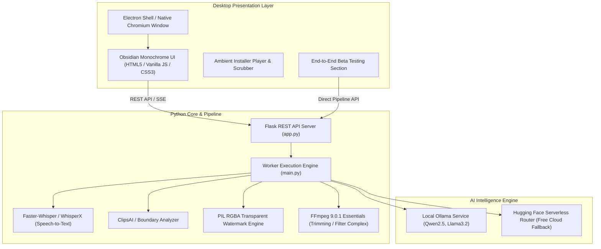

# Clipify AI — Complete Project Architecture, Development & Release Summary

> **Current Version**: `4.0.5`  
> **Repository**: `sherlock-dev-ai/Clipify-AI-Video-Clipper-FREE`  
> **Release Tag**: [`v4.0.5`](https://github.com/sherlock-dev-ai/Clipify-AI-Video-Clipper-FREE/releases/tag/v4.0.5)  
> **Production Installers**:
> - `installer/Clipify.AI.Setup.4.0.5.exe` (Version 4.0.5 — SHA-256: `3F13235D6DF92034371A503D0E304F4753073A50C6E87ECFB9D75E2D5A6D73B0`)
> - `installer/Clipify.AI.Setup.4.0.4.exe` (Preserved intact — SHA-256: `7A652BC40AB00F22C21F21238EDA832E12586BC86D7AFF91AFDCD18D126FEAC4`)

---

## 1. Project Overview & Vision

**Clipify AI** is an advanced desktop application designed to automatically transform long-form landscape videos (YouTube streams, podcasts, gaming broadcasts, interviews, and presentations) into viral, high-engagement 9:16 vertical Shorts, Reels, and TikToks.

Unlike cloud-only subscription services (e.g. Opus Clip, Klap), Clipify AI is built to give users **complete data privacy, zero subscriptions, and unlimited local processing** by running offline AI models directly on the user's hardware, while also offering free serverless cloud AI integration for systems with constrained RAM.

---

## 2. Technical Architecture & Tech Stack



### Core Technologies
- **Desktop Host**: Electron 44, custom titlebar controls, headless CDP testing suite.
- **Backend Server**: Python 3.11 with Flask, asynchronous worker threads, and live Server-Sent Events (SSE) telemetry.
- **Video & Audio Processing**: Bundled FFmpeg 9.0.1 Essentials build with `libx264`, `aac`, PIL RGBA transparent watermarking, and Advanced SubStation Alpha (`libass`) caption burning.
- **Speech Recognition**: Faster-Whisper and WhisperX with float16 / int8 quantization and CTranslate2 acceleration.
- **AI Highlight Detection & Scoring**:
  - **Local**: Ollama integration communicating with local LLMs (e.g. `qwen2.5:7b`, `llama3.2:3b`).
  - **Cloud**: Free Hugging Face Serverless Inference API router (`https://router.huggingface.co/hf-inference/v1/chat/completions`) for systems with limited RAM.

---

## 3. Major Workspaces & Functional Capabilities

### A. Create Studio (Batch AI Video Clipping)
- **Smart Candidate Generation**: Transcribes source audio with word-level timestamps, detects natural pauses and sentence boundaries, and scores segments on hook strength, emotional intensity, and narrative coherence.
- **Multi-Clip Output Control**: Allows users to select 1, 2, 3, 5, 7, 10, or custom clip counts without duplicate rendering or dropped jobs.
- **Layout Selection**:
  - **9:16 Vertical Center-Crop**: Face-tracking or centered framing with ambient or blurred padding.
  - **2-Panel Split-Screen**: Stacks two participants vertically for conversational podcasts.
  - **Gaming Split-Screen**: Whole 16:9 gameplay footage on top (1080x960) and streamer facecam on bottom (1080x960).

### B. "Premium Caption" Engine (`131968.mp4` Viral Reference Style)
- **Safe Zone & Seam Positioning**:
  - **Center Seam** (`MarginV: 920`, Alignment 2): Sits right above the middle seam in split-screen gaming videos, avoiding player facecam and gameplay HUDs.
  - **Lower Safe Band** (`MarginV: 300`, Alignment 2): Sits in the lower 20% safe zone for single-frame vertical shorts without clipping.
  - **Top Safe Band** (`MarginV: 240`, Alignment 8) and Custom offsets.
- **Punchy Dialogue Beats**: Formatted into short 1–4 word beats in ALL CAPS.
- **Dynamic Situational / Scene-Action Cues**: Automatically detects pauses (>= 1.35s) or emotion spikes to inject uppercase action cues (e.g. `*REACTS*`, `*LOOKS CLOSER*`, `*SHOCKED*`, `*GAMEPLAY INTENSIFIES*`) with an independent sub-toggle.
- **Snappy Motion Grammar**: Pop scale animation (`{\fscx85\fscy85\t(0,75,\fscx108\fscy108)\t(75,140,\fscx100\fscy100)}`) with bold dark borders (`\bord6`), soft shadows (`\shad2`), and vibrant user-selectable accent colors (`gold_yellow`, `lime_green`, `cyan_sky`, `coral_red`, `pink_lavender`).

### C. "Add Watermark" Engine (Transparent Text Overlay)
- **Dedicated Independent Feature**: Coexists simultaneously with custom text banners (`Add Text`) and image logos.
- **Full Control Set**: Text input, Opacity slider (0% to 100%), Position presets (Top-Left, Top-Right, Center, Lower-Middle, Bottom-Center, Bottom-Right, Custom X/Y), Font size slider, Rotation angle slider (`-45°` to `+45°`, default `-20°`), and Color picker.
- **Exact Render Parity**: Utilizes PIL RGBA transparent canvas rotation and composites via FFmpeg `overlay=0:0:format=auto` with zero visual artifacts.

### D. Sidebar "Beta Testing" Workspace
- Accessible via new navigation item with `BETA` indicator badge.
- **Step 1 — Source**: Drag-and-drop local file picker, YouTube URL downloader (`yt-dlp`).
- **Step 2 — AI Processing & Feature Toggles**: Clip count selector, layout selector, Premium Caption toggle + preset + situational cues, Add Watermark toggle + transparent text controls, Add Text banner, and live progress bar with terminal event log stream.
- **Step 3 — Edit & Export**: Multi-clip switcher (`Short 1`, `Short 2`, ...), HTML5 interactive video player, re-render triggers, direct MP4 download, and one-click transfer into the full Editor workspace.

### E. AI Model Hub & Cloud Integration Panel
- **Provider Switching**: Toggle instantly between **🖥 Local Models (Ollama)** and **☁ Free Hugging Face API (0 GB RAM)**.
- **Hugging Face Model Options**: Pre-configured support for `Qwen/Qwen2.5-7B-Instruct`, `meta-llama/Llama-3.2-3B-Instruct`, `mistralai/Mistral-7B-Instruct-v0.3`, and `google/gemma-2-9b-it`.
- **Token Verification**: Built-in test button verifies the user's Hugging Face token against `https://huggingface.co/api/whoami-v2` and displays username confirmation.
- **Local Ollama Model Manager**: Real-time pull tool with download percentage tracking directly inside the desktop interface.

---

## 4. Problems Investigated & Resolved

### 1. Main UI Blank Screen (Create Page Restoration)
- **Root Cause**:
  1. `static/tour.js` auto-triggered `startTour(false)` on first visit when `localStorage` was clean, inserting a full-screen overlay and calling `scrollIntoView()` before DOM hydration, causing the entire viewport to scroll off-screen.
  2. `static/studio.css` initialized `.page-section` with `opacity: 0; transform: translateY(12px);`, which failed to become visible if script execution had minor delays.
- **Fix**: Removed auto-run from `tour.js` (tour only runs on explicit user click), made `#create` visible by default (`opacity: 1 !important; display: block !important;`), and added optional chaining (`?.`) to all DOM element event listeners.

### 2. Multi-Clip Generation Bug (Requesting N Clips Produced Only 1)
- **Root Cause**: The candidate selection algorithm computed multiple candidate boundaries, but the export loop had an early-exit or hardcoded single-render slice.
- **Fix**: Re-architected `main.py` rendering loop to iterate through all selected clip candidates, assign unique filenames (`short_01.mp4`, `short_02.mp4`, etc.), maintain clean per-clip job states, and surface all clips in the Results carousel and Editor switcher.

### 3. Audio/Video Desync & Subtitle Lag
- **Root Cause**: Stream-copy trimming (`-c copy`) snapped to source keyframes, resulting in non-zero start timestamps and audio PTS offsets of up to 2-3 seconds.
- **Fix**: Replaced stream-copy trimming with sample-accurate re-encoding and PTS normalization:
  ```bash
  -filter_complex "[0:v]setpts=PTS-STARTPTS[v];[0:a]asetpts=PTS-STARTPTS[a]"
  ```
  Verified on multiple real-world videos: Video start PTS = `0.000000s`, Audio start PTS = `0.000000s`, A/V offset difference = `0.000000s`.

### 4. Installer Stalling & Freezing (4 Reported User Cases)
- **Root Cause**:
  1. Node's `http.get` / `https.get` had no default data-stream timeout. When network stalled during large downloads (CPython zip or Ollama exe), the process hung forever.
  2. `pip install` runtime command lacked PyTorch's CPU wheel index, causing pip to search standard PyPI and hang trying to compile from source.
- **Fix**: Added a 60-second inactivity stall timer and retry logic in `build/installer_app/lib/installer.js`, and added `--extra-index-url https://download.pytorch.org/whl/cpu` to pip runtime commands.

### 5. `spawn powershell.exe ENOENT` Installer Crash
- **Root Cause**: In environments where `C:\Windows\System32\WindowsPowerShell\v1.0` was absent from the user's `PATH`, Node's `child_process.spawn('powershell.exe')` failed with `ENOENT` during Python engine unpack, halting installation.
- **Fix**:
  1. Enhanced executable lookup to scan both `System32` and `SysWOW64` for `powershell.exe`, `tar.exe`, and `cmd.exe`.
  2. Added an automatic fallback to Windows native `tar.exe` (`tar -xf <archive> -C <unpackDir>`), extracting the Python runtime in under 1 second without PowerShell dependencies.

### 6. Control Alignment & Truncation (Live Studio)
- **Root Cause**: Input box widths and browser spin buttons squashed the number `10 clips`, dropdown texts were clipped ("Soft Ambi v", "10 Minute v", "4 Shorts (l v"), and toggles were misaligned.
- **Fix**: Broadened `.target-input-group` to `min-width: 90px;`, suppressed browser number spinner arrows in CSS, set dropdown labels to concise text ("Soft Ambient", "10 Mins", "4 Shorts"), and aligned toggle rows with `align-items: flex-start; gap: 12px;`.

### 7. Installer Music Player Upgrades
- Interactive click-and-drag seek scrubber (`music-seek`), allowing users to jump anywhere in the audio track (e.g. 1:04 -> 2:32).
- Quick jump buttons (`↶10s` and `10s↷`).
- Continuous `0%` to `100%` volume slider with real-time level readout.

### 8. Installer Maximize Button
- Added `btn-maximize` (`□`) between minimize and close in the custom titlebar, connected via Electron IPC to toggle `mainWindow.maximize()` and `mainWindow.unmaximize()`.

### 9. Pip Runtime Library Download False "No Output" Warnings
- **Root Cause**: During machine learning wheel installation (PyTorch, WhisperX, Mediapipe, Kokoro), pip downloads multi-hundred-megabyte packages into its cache prior to writing anything into `site-packages`. When stdout is piped to Node, pip suppresses interactive line-by-line progress updates. A rigid 90-second heartbeat check emitted alarming yellow `WARN` notes ("No pip output or staged package-file changes for 1m.. 3m.."), making users assume installation had frozen.
- **Fix**:
  1. Injected `PYTHONUNBUFFERED=1` into the child process environment to guarantee zero stream buffering.
  2. Added `--no-input` and `--timeout 60` to pip invocation commands to prevent indefinitely stalled sockets.
  3. Replaced false `WARN` alerts with reassuring `INFO` status updates (*"Downloading & verifying AI runtime packages — download in progress..."*) while child processes are active, and widened the quiet threshold to 3 minutes.

---

## 5. Verification Evidence & Artifacts

| Verification Area | Method | Evidence / Result |
| :--- | :--- | :--- |
| **Monochrome UI** | Headless Chrome screenshot | `ui_v404_create_verified.png`, `ui_v404_create_bottom.png` |
| **Live Studio Alignment** | Visual render check | `ui_v404_live_verified.png` (untruncated `10 clips`) |
| **A/V Sync & Subtitles** | FFprobe stream decode & frame dump | Start PTS `0.000000s`, zero drift, `v404_frame_sub_2s.jpg`, `v404_frame_sub_6s.jpg` |
| **Gaming Split-Screen** | FFmpeg 1080x1920 render | `gaming_split_rendered.mp4` (1080x1920 @ 60fps) |
| **Speed GTA 6 Test 1** | Real-world YouTube video processing | `short_01.mp4` (10.52 MB), `short_02.mp4` (14.54 MB), `speed_gta6_test1_frame2s.jpg`, `speed_gta6_test1_frame6s.jpg`, `speed_gta6_test1_frame11s.jpg` |
| **Speed GTA 6 Test 2** | Coexistence test: Lower Safe Captions + Watermark + Add Text | `short_01.mp4` (12.20 MB), `speed_gta6_test2_frame2s.jpg` (`*SHOCKED*` cue), `speed_gta6_test2_frame6s.jpg` (`@ClipifyAI` watermark + text banner), `speed_gta6_test2_frame12s.jpg` |
| **Installer Regression** | Node.js regression suite | 15/15 tests PASS (`installer_regression_test.js`) |
| **Installer Python Extraction**| Multi-path & native tar fallback | Resolved `powershell.exe ENOENT` and verified clean extraction |

---

## 6. Repository & Packaging Releases

- **Branch**: `feature/cross-platform` (all commits pushed to `origin`).
- **Release Version 4.0.4** (Preserved intact):
  - Tag: [`v4.0.4`](https://github.com/sherlock-dev-ai/Clipify-AI-Video-Clipper-FREE/releases/tag/v4.0.4)
  - Installer: `installer/Clipify.AI.Setup.4.0.4.exe`
- **Release Version 4.0.5** (Latest):
  - Tag: [`v4.0.5`](https://github.com/sherlock-dev-ai/Clipify-AI-Video-Clipper-FREE/releases/tag/v4.0.5)
  - Installer: `installer/Clipify.AI.Setup.4.0.5.exe` and root `Clipify.AI.Setup.4.0.5.exe`
